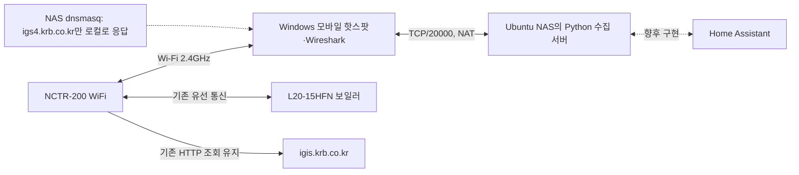

# NCTR-200 WiFi 로컬 제어 프로젝트

문서 정리·코드 확인일: 2026-11-21(KST)  
문서에 기록된 마지막 실기 검증: 2026-10-19 00:08경(KST). 새 도구의 실물 시험은 준비 완료, 미실행

귀뚜라미 보일러 `L20-15HFN`에 연결된 단독 조절기 `NCTR-200 WiFi`의 네트워크 통신을 분석하고, 제조사 클라우드를 대신할 로컬 TCP 게이트웨이를 개발하는 프로젝트입니다. 최종 목표는 기존 조절기의 화면·버튼·펌웨어를 유지하면서 Home Assistant에서 난방·온수·외출 상태를 조회하고 제어하는 것입니다.

현재 폴더는 Python 실험 서버, 패킷 캡처, Android 진단 로그, 역공학 문서로 구성되어 있습니다. **로컬 연결과 일부 제어 가능성을 확인한 연구 단계이며, Home Assistant 통합과 완전한 오프라인 운용은 아직 구현·검증되지 않았습니다.**

## 읽는 순서와 기준 문서

1. 이 문서에서 프로젝트 구조와 검증 범위를 확인합니다.
2. [2026-10-19 개발 인수인계](NCTR200_WiFi_Local_Gateway_Handoff_2026-10-19.md)에서 프로토콜, 실기 기록, 실행 방법, 후속 과제를 확인합니다. 현재 실기 결과를 판단하는 기준 문서입니다.
3. [통신 수집·기능 검증 실험 계획](NCTR200_Local_Control_Experiment_Plan.md) 3판에서 기능별 목표와 현재 구현 범위를 확인합니다.
4. [실물 시험 현장 절차](NCTR200_Ubuntu_Field_Test_Runbook.md)에 따라 준비부터 회수까지 진행합니다. 현재 구성은 Windows 모바일 핫스팟 + Ubuntu NAS(dnsmasq·수집 서버) + 아이패드 SSH입니다. 회차별 조작·marker는 [현장 체크리스트](NCTR200_Field_Marker_Checklist.md)를 사용합니다.
5. [메시지 참조](NCTR200_Message_Reference.md)에서 확인된 메시지·명령 형식과 근거 수준을 확인합니다.
6. [자체 프로비저닝 시험](NCTR200_Self_Provisioning.md)에서 DNS 없이 조절기를 로컬 서버로 붙이는 방법을 확인합니다.
7. [시험 기록](NCTR200_Test_Log.md)에서 10월~11월 22일의 회차별 시험과 캡처, 주제별 결론을 확인합니다. 공개 저장소로 옮길 수 있게 개인 정보를 뺐습니다.
8. [현재 CLI](../src/nctr_lab_cli.py)와 [자동 시험](../tests/test_lab.py)을 확인합니다. v4는 `src/archive/`에 원문 보존했습니다.

기존 시작 안내가 10월 19일 인수인계를 최신 기준으로 지정하고 있고, 해당 문서가 10월 15~17일의 미해결 사항 중 후속 실험으로 확인된 내용을 반영하므로 이 기준을 유지했습니다. 10월 25일 문서 정리는 새로운 실기 성공을 의미하지 않습니다.

## 통신 구조와 개발 방향

제조사 구성에서는 Android 앱이 HTTPS REST로 명령을 보내고 MQTT로 상태를 받으며, 조절기는 제조사 서버와 TCP/20000으로 통신합니다. 로컬 게이트웨이는 이 중 **조절기와 TCP로 통신하는 서버 역할**을 구현합니다.



현재 성공 기록은 `igs4.krb.co.kr`의 DNS 응답을 로컬 서버로 바꾸는 방식입니다. `igis.krb.co.kr/serverConnectionNormalInfo` 조회는 제조사 경로를 유지했으므로, 인터넷을 차단하고 재부팅해도 동작한다는 근거는 아직 없습니다. 전용 프로비저닝으로 로컬 서버 주소를 직접 설정하는 방식도 후속 과제입니다.

## 현재까지의 성과와 근거 수준

아래 최신 실기 결과는 **기존 인수인계에 기록된 결과**입니다. 이번 개발에서는 Windows 모의·loopback 시험과 기존 PCAP 3개의 프레임 재조립·재생 검증을 수행했습니다. 새 코드의 Ubuntu·실물 접속이나 10월 18~19일 LCD 관측을 다시 검증하지는 않았습니다.

| 항목 | 기록 또는 구현 상태 | 해석의 범위 |
|---|---|---|
| 자체 서버 연결 | 10월 18~19일 DNS 우회로 Ubuntu TCP/20000 접속 기록 | 제조사 계정 미등록 상태의 로컬 접속 성공 기록입니다. |
| 식별과 초기 상태 교환 | `0001`에서 8바이트 ID 학습, `01FF` 103바이트 상태 보고와 ACK, `ready=True` 기록 | 전체 상태 필드가 해독됐다는 뜻은 아닙니다. |
| 원격 목표온도 명령 | 자체 서버의 `0102` 전송과 같은 토큰의 ACK, 28°C 명령 후 운전 시작에 대한 사용자 관측 | 후속 보고가 이전 목표값을 보인 사례가 있어 적용·상태 동기화는 미완성입니다. |
| 물리 다이얼 이벤트 | 26→27°C 조작과 장치발 `0102`의 body byte 4 `1A→1B` 대응 기록 | 이 조작에서 목표온도 필드가 확인됐습니다. 현재온도 후보 byte 2, `ownerState`는 추가 검증이 필요합니다. |
| 외출 이벤트 | 물리 버튼 조작과 장치발 `0106` 대응 기록 | ON/OFF를 나타내는 값의 방향은 미확정입니다. |
| 등록 코드 | `0002` 응답의 앞 2바이트와 LCD의 4자리 코드가 두 차례 일치한 기록 | v4의 `--pair-code`는 고정 시험 응답이며, 소유권 승인·권한 관리를 구현하지 않습니다. |
| 전체 상태 추적 | v4에 `--trace-state`의 RAW 출력·바이트 차분 구현, 인수인계에 최초 RAW 실기 출력 기록 | 연속된 실기 `01FF` 간 차분 검증은 아직 기록되지 않았습니다. |
| Home Assistant·완전 오프라인 | 현재 파일 목록에 HA 어댑터·MQTT 브리지 구현이 없고, 인수인계에서도 후속 과제로 명시 | 최종 목표이며 완료 기능으로 취급하지 않습니다. |

## 코드와 자료 구성

문서 링크는 이 `docs` 디렉터리를 기준으로 합니다. 인수인계의 서버 실행 명령은 `Boiler_IoT` 루트에서 실행하는 기준입니다.

```text
Boiler_IoT/
├─ src/
│  ├─ nctr_lab_cli.py
│  ├─ nctr_lab/
│  └─ archive/
│     ├─ nctr_local_autoid_server.py
│     ├─ nctr_local_autoid_server_v2.py
│     ├─ nctr_local_autoid_server_v3.py
│     ├─ nctr_local_autoid_server_v4.py
│     └─ read_nctr.py
├─ tests/
├─ tools/
│  ├─ nctr_field.sh
│  └─ nctr_windows_field.ps1
├─ captures/
├─ experiments/
├─ dist/
├─ docs/
│  ├─ README.md
│  ├─ NCTR200_WiFi_Local_Gateway_Handoff_2026-10-19.md
│  ├─ NCTR200_Local_Control_Experiment_Plan.md
│  ├─ NCTR200_Ubuntu_Field_Test_Runbook.md
│  ├─ NCTR200_Preflight_Validation_2026-10-25.md
│  ├─ NCTR200_Field_Marker_Checklist.md
│  ├─ NCTR200_Message_Reference.md
│  ├─ NCTR200_Self_Provisioning.md
│  ├─ NCTR200_Test_Log.md
│  └─ archive/
└─ ADB/
```

`src/`에는 현재 수집·분석 도구를 두고, v4까지의 단일 파일 서버와 초기 진단 스크립트는 `src/archive/`에 보관합니다. 기존 패킷 캡처 5개는 `captures/`, 새 수집·분석 자료는 `experiments/`, 배포 ZIP은 `dist/`를 사용합니다. 기존 자료의 내용은 유지했습니다.

| 경로 | 역할 |
|---|---|
| [src/nctr_lab_cli.py](../src/nctr_lab_cli.py), [nctr_lab](../src/nctr_lab/__init__.py) | 현재 단일 장치 수집 서버·원본 재생·분석·DNS 사전 점검·배포 도구입니다. |
| [tools/nctr_field.sh](../tools/nctr_field.sh) | Ubuntu 현장 시험 보조 함수입니다. 설정 파일 한 곳의 값으로 캡처·수집·종료 정리 명령을 실행합니다. 배포 ZIP에 포함됩니다. |
| [tools/nctr_windows_field.ps1](../tools/nctr_windows_field.ps1) | Windows 핫스팟 구성의 DNS 백업·변경·확인·원복, 실행 폴더 회수, Wireshark 캡처 첨부를 수행합니다. |
| [tests/test_lab.py](../tests/test_lab.py) | 합성·loopback 모의 시험입니다. 실물이나 외부 서버에 접속하지 않습니다. |
| [src/archive/nctr_local_autoid_server_v4.py](../src/archive/nctr_local_autoid_server_v4.py) | 과거 실기 동작이 기록된 v4 원문입니다. 새 도구의 초기 응답·정책 비교 기준으로 보관합니다. |
| [src/archive/nctr_local_autoid_server_v3.py](../src/archive/nctr_local_autoid_server_v3.py) | 온도 시험 범위 확장과 장치발 `0102` 표시를 추가한 이전 버전입니다. |
| [src/archive/nctr_local_autoid_server_v2.py](../src/archive/nctr_local_autoid_server_v2.py) | 접속 전에도 사용할 수 있는 CLI, 현재 연결의 준비 상태 확인, 출력 오류 처리 등을 포함한 이전 버전입니다. |
| [src/archive/nctr_local_autoid_server.py](../src/archive/nctr_local_autoid_server.py) | ID 자동 학습·핸드셰이크·제한적 온도 명령을 구현한 초기 버전입니다. |
| [src/archive/read_nctr.py](../src/archive/read_nctr.py) | 조절기 AP `192.168.200.1:20000/UDP`로 AT 조회를 보내는 초기 진단 스크립트입니다. 실행하면 즉시 송신합니다. |
| `captures/261015_packet.pcapng`, `captures/261015_packet_boiler.pcapng`, `captures/261015_test.pcapng` | 초기 통신 분석 및 AP 조회 시험과 관련된 10월 15일 캡처 자료입니다. |
| `captures/261017_packet_bolier.pcapng`, `captures/261017_packet_bolier2.pcapng` | 재설정·등록 코드 분석과 관련된 10월 17일 캡처 자료입니다. 실제 파일명의 `bolier` 표기를 유지했습니다. |
| `ADB/platform-tools/` | ADB 실행 도구와 `nctr_full_logcat.txt`, `setup_log.txt`가 있습니다. |
| `ADB/platform-tools-latest-windows.zip` | Android platform-tools 배포 압축 파일입니다. |
| 이전 인수인계 묶음 ZIP | 문서와 v4 코드를 묶었던 당시 배포본입니다. 내부 경로는 정리 전 상태로 보존했습니다. |

폴더 전체에서 APK/디컴파일 Java 원본인 `standalone.zip`, `kiturami.zip`, 과거 문서의 `nctr_local.py`, 추출 CSV, 로컬 서버 실행 로그 `nctr_trace.log`·`nctr_control_trace.log`는 확인되지 않았습니다. 따라서 현재 보유한 Python 코드와 과거 APK 분석 보고서를 구분해야 합니다. PCAP 5개와 Android 로그는 실제로 존재합니다.

## 현재 도구와 검증 결과

새 도구는 모든 RX/TX 원본과 미해독 프레임을 보존하고 ACK·상태 보고·명령 결과를 구분합니다. Windows에서 코드를 관리하고, 조절기는 Windows 핫스팟에 연결하며, Ubuntu NAS에서 dnsmasq와 수집 서버를 실행하는 구성을 기준으로 합니다. 현장 반복 작업은 [tools/nctr_field.sh](../tools/nctr_field.sh)와 [tools/nctr_windows_field.ps1](../tools/nctr_windows_field.ps1)로 줄였습니다. 자세한 기능·실행·복구는 현장 절차를, 자동 시험과 PCAP 검증 결과는 [사전 검증 기록](NCTR200_Preflight_Validation_2026-10-25.md)을 참고합니다. 실제 보일러로 검증한 기능과 모의 시험으로 검증한 코드를 구분해야 합니다.

## 보관된 v4의 처리 흐름

1. `Server`가 TCP 포트를 열고, IP 제한이 있으면 접속 주소를 확인합니다. 동시에 활성화된 시험 연결은 하나만 허용합니다.
2. `Session.serve()`가 수신 바이트를 버퍼에 누적하고 `ID 2B + length 2B + token 2B + body` 형식으로 프레임을 분리합니다.
3. 기본값인 `observe` 모드에서는 수신·식별만 기록합니다. `handshake` 모드에서는 `0000`·`0001` 초기 교환, `01FF` 및 일부 장치발 이벤트의 ACK를 처리합니다.
4. 같은 연결에서 `0001`과 `01FF`를 수신한 뒤 세션이 준비 상태가 됩니다. `status`와 `wait N`으로 확인할 수 있습니다.
5. 온도 명령은 `--enable-temperature`, 준비된 현재 세션, 18~30°C 범위, CLI의 `SEND` 확인을 거쳐 한 번 전송합니다. 지원 범위와 실제 적용 결과는 물리 조절기에서 확인해야 합니다.

v4는 Python 표준 라이브러리를 사용하며 `ZoneInfo("Asia/Seoul")` 시간대 데이터와, ID 파일 저장 시 `os.fchmod`를 사용합니다. 기존 실험의 실행 대상은 Ubuntu입니다. Windows에서 같은 실행 조건이 충족되는지는 이번에 검증하지 않았습니다.

`0001` 응답은 길이 필드 11과 실제 후속 바이트 10의 불일치를 그대로 모방하고, 마지막 2바이트를 `--time-tail`로 받습니다. `0123`은 해독된 정답이 아닙니다. 또한 전송 명령은 `pending`에 기록하지만 현재 코드에는 응답 타임아웃·재전송·실제 적용 확인을 완성한 처리가 없습니다. 운영용 서비스로 전환하기 전에 해결해야 합니다.

## 다음 작업의 우선순위

실물 수집 전 코드·모의 시험·현장 보조 스크립트를 구현했고, NAS에 배포 묶음을 배치해 해시 검사를 통과했습니다. 다음은 현장 절차 5~7절대로 DNS·포트를 확인한 뒤 회차 0(핫스팟 프로비저닝)부터 제어 없는 수집 회차를 진행하는 것입니다. 그 자료로 기능별 인코더를 확장하고 원격 결과를 비교합니다. 아래 기술 과제의 범위·진입 조건은 현재 실험 계획과 현장 절차를 따릅니다.

1. **상태 의미 확정:** `0102`의 현재온도·`ownerState`, 원격 명령 이후 보고 불일치, `0106` ON/OFF, 연속된 `01FF`의 차분을 LCD 기록과 대조합니다.
2. **세션 신뢰성:** `0001` 길이·미해독 2바이트, `0000` 선행 연결, 연결 끊김·재접속, 응답 타임아웃과 중복 처리를 검증합니다.
3. **승인과 권한:** `0002` 코드를 이용한 일회용 페어링, 만료·시도 제한·장치 바인딩을 구현합니다. 평문 ID 학습과 제어 권한 부여는 별도로 관리합니다.
4. **제조사 독립성:** `AT+SCON`·`AT+ABCD` 역할, 자체 프로비저닝, 제조사 HTTP 요청 제거, 인터넷 차단·재부팅 이후 복구를 검증합니다.
5. **Home Assistant 통합:** 상태 모델을 정리한 뒤 MQTT 브리지 또는 직접 통합을 구현합니다. ACK와 실제 적용 상태를 구분해 노출합니다.

## 이전 문서 보관 목록

`docs`에는 이 안내, 최신 실기 인수인계, 현재 계획·현장 절차·사전 검증 기록을 두고 이전 문서와 배포 묶음은 `docs/archive`에 보관합니다. 보관 원문에는 과거 판정·옛 파일명·`references/` 경로가 남아 있을 수 있습니다. 현재 코드 실행은 현장 절차를, 과거 실기 판정은 10월 19일 인수인계를 기준으로 합니다.

| 문서 | 기록 범위 |
|---|---|
| [Java 정적 분석](archive/NCTR200_WiFi_Standalone_Java_Audit.md) | 초기 Android 앱 구조, API, 명령 인코딩 분석입니다. |
| [로컬 제어 종합 분석](archive/NCTR200_WiFi_Local_Control_Reverse_Engineering.md) | 10월 15일 기준 하드웨어 이력, 구현 대안, APK·PCAP 분석과 설계입니다. |
| [로컬 서버 전환 상태](archive/NCTR200_WiFi_Local_Server_Reverse_Engineering_Status_2026-10-15.md) | 10월 15일 AP 접근·AT 조회 실패와 제조사 통신 분석 기록입니다. |
| [DNS·미등록 시험 계획](archive/NCTR200_DNS_AutoNode_From_AP_Reset_2026-10-17.md) | 10월 17일 기준 AP 초기화 후 DNS 우회·ID 자동 학습 시험 계획입니다. |
| [이전 시작 안내](archive/NCTR200_README_START_HERE.md) | 당시 ZIP 배포본의 읽는 순서와 포함 자료 안내입니다. |
| [실험 계획 1판](archive/NCTR200_Local_Control_Experiment_Plan_2026-10-25_Rev1.md) | v4 중심의 초기 관찰·온도 검증 계획입니다. |
| [실험 계획 2판](archive/NCTR200_Local_Control_Experiment_Plan_2026-10-25_Rev2.md) | 수집·기능 검증 범위를 확대한 구현 전 계획입니다. 현재는 3판을 사용합니다. |

기존 코드·PCAP·ADB 자료는 내용과 해시를 보존했습니다. 새 수집·분석 도구와 모의 시험, Ubuntu 배포·현장 절차를 추가했습니다. 실제 장치·DNS 설정 변경이나 새 실물 제어 시험은 수행하지 않았습니다.
