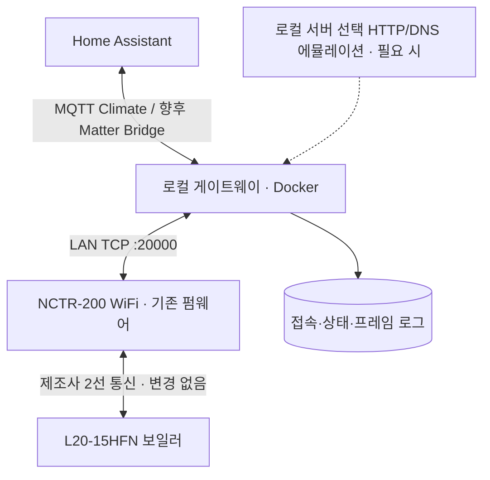

# 귀뚜라미 NCTR-200 WiFi 로컬 제어 역공학 기술 정리

> **기준일:** 2026-10-15  
> **대상:** 귀뚜라미 거꾸로 ECO 콘덴싱 **L20-15HFN** + **NCTR-200 WiFi**  
> **목표:** 제조사 클라우드 의존도를 제거하고, 기존 온도조절기의 난방·온수 기능을 유지하면서 Home Assistant에서 로컬 제어  
> **진행 상태:** 제품 교체 및 제조사 서버 통신 캡처 완료 / 독립 로컬 서버 연결·제어 미검증

## 목차

1. [프로젝트 개요 및 현재 상태](#1-프로젝트-개요-및-현재-상태)
2. [하드웨어 및 설치 이력](#2-하드웨어-및-설치-이력)
3. [검토한 구현 방법](#3-검토한-구현-방법)
4. [APK 역공학: 앱·서버·초기 설정](#4-apk-역공학-앱서버초기-설정)
5. [APK 역공학: 명령과 상태 메시지](#5-apk-역공학-명령과-상태-메시지)
6. [PCAPNG 분석: 실제 장치 통신](#6-pcapng-분석-실제-장치-통신)
7. [로컬 게이트웨이 구현 설계](#7-로컬-게이트웨이-구현-설계)
8. [다음 검증 단계와 안전·복구 조건](#8-다음-검증-단계와-안전복구-조건)
9. [확인된 사실과 미확인 사항](#9-확인된-사실과-미확인-사항)
10. [자료·소스 위치와 참고 링크](#10-자료소스-위치와-참고-링크)

---

## 1. 프로젝트 개요 및 현재 상태

### 1.1 사용 환경

| 항목 | 내용 |
|---|---|
| 보일러 본체 | 귀뚜라미 거꾸로 ECO 콘덴싱 `L20-15HFN` |
| 기존 실내 온도조절기 | `NCTR-70` |
| 구입·장착한 교체 조절기 | `NCTR-200WIFI` (나노켐/귀뚜라미 계열) |
| 제어 방식 | 거실 **단독 조절기**, 각방제어 시스템 아님 |
| 대상 Android 앱 | 귀뚜라미보일러 **IoT 매니저**, 패키지 `kr.openfloor.kituramiplatform.standalone` |
| 패킷 수집 | Windows 모바일 핫스팟 + 패킷 캡처(`.pcapng`) |
| 장기 연동 대상 | Home Assistant(Docker) 및 필요 시 Matter Bridge |
| 희망하는 운영 조건 | LAN 내부에서 상태 조회·난방 제어, 인터넷/제조사 API에 의존하지 않음 |

- 판매 페이지에서 `NCTR-70`이 `NCTR-200WIFI`의 교체 가능 조절기 목록에 **명시**되어 있었다. 단독 조절기 조건이며 각방제어 시스템은 제외한다.
- 구입 시 표시된 상품가는 **85,000원 + 배송비 3,000원**이었다(당시 판매 화면 기준; 일반적인 현재 시세라는 뜻은 아님).
- NCTR-200 WiFi를 실제 장착하여 전원이 켜졌으며, 이후 해당 기기의 제조사 서버 통신을 캡처했다.
- **아직 성공하지 못한 단계:** 기기 TCP 목적지를 자체 서버로 변경하여 지속 연결시키고, 제조사 서버 없이 제어하는 단계.

### 1.2 프로젝트의 실질적 성과

처음에는 NCTR-70의 2선식 통신 프로토콜을 직접 역공학해야 한다고 보았다. 이후 다음 증거가 쌓이면서 **기존 NCTR-200 펌웨어를 유지한 로컬 TCP 게이트웨이**가 우선 경로가 됐다.

1. 앱 코드에 모델별 TCP 서버 주소를 Wi-Fi 모듈에 설정하는 절차가 존재한다.
2. 앱의 온도·전원·외출 명령 인코더/상태 디코더를 확보했다.
3. 실제 PCAP에서 **장치 ↔ 서버 TCP:20000**, 바이너리 프레이밍, 제어 명령 및 ACK를 확인했다.
4. 명령 본문이 앱의 `Message*` 클래스가 생성하는 6바이트와 일치하는 사례가 관측됐다.

**판단:** 서버 주소 변경과 핸드셰이크만 구현할 수 있다면, 하드웨어 개조나 MCU 펌웨어 재작성 없이 LAN 제어가 가능할 개연성이 있다. **가능성이 검증 완료를 의미하지는 않는다.**

**바로 다음 작업:** (1) 현재 정상 연결의 핸드셰이크와 `01FF` 패킷 추가 분석 → (2) 기존 설정 복구 절차 확보 → (3) 수신 전용 로컬 서버 접속 시험.

---

## 2. 하드웨어 및 설치 이력

### 2.1 L20-15HFN 설명서에서 확인한 내용

제공된 「거꾸로 ECO 콘덴싱 L20 가스보일러 사용설명서」 관련 항목:

| 설명서 | 확인한 사항 | 시사점 |
|---|---|---|
| 21페이지, `2 Room` | 기존 조절기 통신선에 추가 실내 조절기 한 세트를 연결하는 구성 안내 | 단일 조절기 전용의 단순 접점은 아님. 두 조절기가 같은 통신 경로를 사용할 수 있음. |
| 47페이지, 설치방법 | 실내 온도조절기 2선 연결·극성(`+`/`−`)과 통신 관련 안내 | 색상만으로 결선하지 말고 실제 단자 표시 확인 필요 |
| 49페이지, DIP 설정 | 보일러 내부 제어 관련 설정 안내 | 별도 외부 무전압 난방 요구 접점은 이 자료에서 확인되지 않음 |

- 기존 조절기의 2선식 연결은 **Nest Heat Link 또는 일반 릴레이의 단순 접점으로 대체 가능한 규격이라고 확인되지 않았다.**
- 온도조절기 인터페이스가 **UART/RS-485라는 것 역시 미확인**이다. `SMD 통신`이라는 카탈로그 표현만으로 물리계층을 결정할 수 없다.
- 제조사가 허용한 외부 무전압 접점의 존재 여부도 계속 **미확인**이다. Nest 직접 결선은 권장하지 않는다.

### 2.2 실제 교체·배선 결과

기존 사진과 현장 재결선 결과를 정리한 표이다.

| 벽면 배선 묶음 | 기존 NCTR-70에 연결된 리드선 | 새 NCTR-200에 연결하여 **부팅된** 리드선 |
|---|---|---|
| 녹색 + 검정색 | 빨간색 | **흰색** |
| 빨간색 + 회색으로 보인 선 | 흰색 | **빨간색** |

**중요한 주의:**

- 처음에는 기존 조절기와 같은 색으로 연결했을 때 새 조절기의 화면이 켜지지 않았다.
- 두 연결을 **맞바꾼 후 새 조절기의 화면이 켜졌다.** 이는 현장 관측 사실이다.
- 그러나 **부팅만으로 실제 단자 극성·절연·전기적 호환성 또는 장시간 안전성이 입증된 것은 아니다.** 기존 선 색상만 보고 `+`, `−`를 확정해서도 안 된다.
- 원인(기존 리드선 표시/현장 배선 실제 극성/새 조절기 커넥터 배치)은 아직 검증되지 않았다. 단자 실제 극성은 제조사 설치자료 또는 적절한 계측을 수행하는 전문가에게 확인받는 것이 안전하다.
- 보일러 내부 안전회로, 가스·연소 제어부는 변경 대상에 포함하지 않는다.

### 2.3 완제품 스마트 서모스탯 검토 결과

- Google Nest·tado° 등 해외 스마트 서모스탯의 국내 보일러 설치 사례는 존재한다.
- 대부분 **별도 무전압 난방 요구 입력** 또는 **분배기 밸브 제어 시스템**을 활용했다.
- `L20-15HFN + NCTR-70`에 Nest를 곧바로 연결해 성공했다는 구체적인 근거는 확보하지 못했다.
- 현재는 **정품 NCTR-200 WiFi를 유지하고 네트워크 경로를 로컬화**하는 전략을 우선한다.

---

## 3. 검토한 구현 방법

| 경로 | 핵심 방식 | 장점 | 제약/상태 |
|---|---|---|---|
| **A. TCP 로컬 게이트웨이** | NCTR-200의 접속 대상을 자체 TCP 서버로 전환 | 기존 LCD·버튼·보일러 제어 펌웨어 유지 | **최우선**, 목적지 변경 및 자체 서버 세션 미검증 |
| B. DNS/HTTP 서버 선택 에뮬레이션 | `igis.krb.co.kr` 조회 및 `/serverConnectionNormalInfo` 응답 구조 분석 | AT 설정 변경이 덮어써질 경우 대안 | DNS 변경만으로는 TCP 목적지 결정 방식 해결 보장 안 됨 |
| C. Wi-Fi 모듈 교체 | 조절기 제어 MCU를 유지하고 통신 SoC를 ESP32 등으로 교체 | Matter 기기를 직접 구현할 수 있음 | 실제 PCB·MCU 간 통신 미확인, 하드웨어 개조 필요 |
| D. 온도조절기 전면 재구현 | 보일러와의 유선 통신까지 독자 MCU로 처리 | 가장 높은 자율성 | 기술·안전 검증 부담 큼 |
| E. 버튼/다이얼 에뮬레이션 | 기존 조절기 내부 입력 회로만 자동화 | 보일러측 유선 프로토콜 불필요할 수 있음 | 정확한 회로·상태 피드백 필수, PCB 개조 필요 |

### Matter 관련 결론

- **Matter over Wi-Fi 구현 자체는 가능**하지만, 현재 NCTR-200의 실제 무선 칩셋·Flash·보안 설정·MCU 분리 여부는 미확인이다.
- 최우선 로컬 TCP 게이트웨이가 성공한다면 먼저 **Home Assistant MQTT Climate 또는 직접 통합**으로 연결하는 것이 단순하다.
- 여러 Matter 컨트롤러에서 쓰려면 추후 **서버 측 Matter Bridge**를 추가하는 선택지가 있다. 이 경우 조절기 자체에 Matter 펌웨어를 설치하는 것은 아니다.
- Matter의 실내온도 Thermostat과 귀뚜라미의 **온돌 난방수 온도·생활온수 온도**는 의미가 다르므로 동일한 설정온도로 합치면 안 된다.

---

## 4. APK 역공학: 앱·서버·초기 설정

### 4.1 분석한 APK 범위

분석에 사용한 파일은 `standalone.zip`, `kiturami.zip`이다.

| 항목 | 확인 값 |
|---|---|
| Android 패키지 | `kr.openfloor.kituramiplatform.standalone` |
| Standalone Java | **201개** |
| 전체 디컴파일 Java | **4,997개** |
| 두 아카이브의 앱 고유 Java | **201개가 바이트 단위로 동일** |
| 차이 | Android 리소스/Manifest/외부 라이브러리 4,796개 등 |
| APK 앱 버전 | `2.8.9` (`versionCode=99`) — 조절기 펌웨어 버전 아님 |
| 기기용 OTA/펌웨어 이미지 | APK에서 발견되지 않음 |

`IoT 매니저(Standalone)`는 **단독 조절기**에 적용되는 앱이며, `IoT 멀티 매니저(Integrated)`는 **각방제어 구성**에 해당하므로 현재 프로젝트 분석 범위에서 제외한다.

> 디컴파일 결과에는 JADX 오류·타입 추론 문제 가능성이 존재한다. 중요 동작은 실행 캡처와 원시 DEX/Smali 등을 교차 확인해야 한다.

### 4.2 앱의 네트워크 경로

| 경로 | 주소·프로토콜 | 관찰/역할 |
|---|---|---|
| 제어 REST | `https://igis.krb.co.kr/api/` | 앱 로그인, 조회, 난방 제어 등 |
| 모델별 초기 설정 조회 | `POST https://igis.krb.co.kr/modelUri` | 모델명과 목적지 `ip`, `uri`, `rnum` 조회 |
| 상태 수신 MQTT | `tcp://iot-mqtt.krb.co.kr:1883` | 앱이 `nodeId` 토픽 구독, 상태 알림 수신 |
| 초기 설정 UDP | `192.168.200.1:20000/UDP` | 임시 AP를 통한 무선 설정 전달 |
| 장치 ↔ 제조사 서버 | `121.141.70.70:20000/TCP` | 실제 PCAP에서 양방향 통신 관측 |
| 서버 상태 조회 | `http://igis.krb.co.kr/serverConnectionNormalInfo` | PCAP에서 부팅 중 호출 확인 |

- 앱의 **명령 송신은 HTTPS REST**이고, MQTT는 **상태 수신·구독**에 사용된다. Java 앱 고유 코드에서 MQTT 제어 `publish()`는 확인되지 않았다.
- MQTT 1883은 앱 측 TLS 없는 연결로 확인됐다. **기기 ↔ 서버 TCP:20000의 보안 기능과는 별개**이다.
- 제조사 MQTT 공용 접속 정보가 APK에 포함되어 있으나, 비밀번호·토큰 등 민감한 자격증명은 이 문서에 복제하지 않는다.
- `device/getServerAddress` API 선언은 존재하나 APK 고유 Java 내 실제 사용처는 확인되지 않았다. 실제 모델별 초기 주소 설정에 쓰인 경로는 `modelUri`이다.

### 4.3 Wi-Fi 초기 설정(Provisioning)

앱 소스의 `Setup.java` → `Setup_Step06.java` → `UDPCommForRC.java` 순서로 확인된다.

1. 조절기를 임시 Wi-Fi AP 모드로 전환한다(앱 안내 SSID: `krb_set`, 앱 리소스에 기재된 기본 접속 암호: `krb12345`). 이는 **초기 설정용 기본값**으로, 기기 펌웨어 버전에 따라 다를 수 있다.
2. Android 단말이 조절기 AP에 연결한다.
3. 앱이 제조사 서버 `modelUri` 응답에서 선택 모델의 `ip`, `uri`, `rnum` 값을 가져온다.
4. `UDP 192.168.200.1:20000`으로 `WizFi250AirCmd:` 접두사의 AT 명령 묶음을 보낸다.
5. Wi-Fi와 TCP 대상 정보를 저장하고 모듈을 재시작한다.

**앱 원본 명령 형태(민감한 Wi-Fi 암호는 자리표시자로 대체):**

```text
WizFi250AirCmd:AT+WSET=0,<SSID>\r
AT+WSEC=0,,<WIFI_PASSWORD>\r
AT+WNET=1\r
AT+SCON=S,TCN,<productIP>,20000,,1\r
AT+ABCD=S,TCN,<productURI>,20000,,1\r
AT+FSOCK=6,15\r
AT+MPROF=S\r
```

별도 `WizFi250AirCmd:AT+MRESET\r`으로 재부팅한다. 위 문자열은 **각 줄의 `\r`이 CR 바이트를 뜻하는 표기**이며, 원본 코드는 하나의 UDP 메시지에 명령 묶음을 구성한다.

| 키워드 | 해석 상태 |
|---|---|
| `WizFi250AirCmd:` | WIZnet WizFi250 계열의 Air Command 형식과 일치 |
| `AT+WSET`/`AT+WSEC` | SSID 및 인증 설정 |
| `AT+WNET=1` | DHCP 사용 |
| `AT+SCON=S,TCN,...` | 저장형 일반 TCP 클라이언트 목적지 설정 |
| `AT+ABCD` | **공개 WizFi250 표준 명령에서 의미 미확인**. 제조사 확장 등 추정 금지 |
| `AT+FSOCK=6,15` | 소켓 연결 유지·재연결 관련 설정(세부 실제 동작 검증 필요) |
| `AT+MPROF=S` / `AT+MRESET` | 프로파일 저장 / 재시작 |

`NCTR-200 WIFI` 문자열이 해당 설정 분기에 명시되어 있지만, **장착된 실물의 Wi-Fi 모듈이 반드시 순정 WizFi250이라는 증거는 아직 없다.** 실제 제품 펌웨어가 다른 방식으로 구현되었을 가능성도 구분한다.

#### `modelUri`의 필드

```json
{
  "modelUrilList": [
    {"modelName": "<모델명>", "ip": "<서버 IP>", "uri": "<서버 URI>", "rnum": "<설정 버튼 이름>"}
  ]
}
```

위 JSON은 **Java 데이터 모델을 도식화한 예시**이며 제조사 서버가 현재 이 값을 반환했다는 실행 로그가 아니다. `rnum`은 앱에서 설정 모드 진입 버튼 안내에 사용한다.

### 4.4 기기 등록/식별

- 기기 등록은 `device/registerDevice` API에서 수행된다.
- 앱은 서버에서 받은 `nodeId`가 **18자**인지 검사한다.
- `MessageDefine.TYPE_NEW_200_BOILER="36"`과 `KituramiDefine.TYPE_NEW_BOILER_200WF=0x36000000` 등의 선언을 확인했다.
- `nodeId`의 시작 문자열 `36`은 200WF 계열의 분류 단서이지만 **실제 구입한 NCTR-200 WiFi의 `nodeId`와 일치하는지는 미확인**이다.
- 자체 서버에 TCP 연결되는 것과 제조사 클라우드 **기기 등록 성공은 별개 단계**이다.

### 4.5 APK에서 확보한 추가 기능 단서

- 예약: `0x0107`(24시간·48개 30분 슬롯), `0x0108`(반복 예약), `0x010C`(주간 예약 관련).
- 서버 스케줄: `configure/getSchedule`, `registerSchedule`, `updateDeviceSchedule` 계열 API. 장치 자체 스케줄과 분리해서 이해해야 한다.
- 여러 방의 ID는 `01,02,04,08,10,20,40,80` 비트마스크로 표현된다. 현재 사용 환경은 단독 조절기다.
- Android 리소스에는 오류 번호와 한국어 설명이 포함되어 있어 HA 알림·진단 화면에 활용할 수 있다. 단, L20-15HFN에서 실제 발생하는 오류 목록과 동일하다는 보장은 없다.
- `AndroidManifest.xml`에 `usesCleartextTraffic=true`, `allowBackup=true` 등 앱 정책이 존재한다. 보일러-서버 구간의 암호화 여부를 이 값만으로 판정할 수 없다.
- 앱 초기 설정 Wi-Fi 목록은 주파수 기준으로 일부 5GHz 항목을 걸러내며, 테스트는 **2.4GHz SSID**가 합리적이다.
- `AT+FOTA`는 WizFi250 제조사 명령 체계에 존재하지만 앱의 201개 고유 Java에는 장치 펌웨어 갱신 경로가 확인되지 않았다. **OTA 부재의 증명은 아님.**

---

## 5. APK 역공학: 명령과 상태 메시지

### 5.1 앱 API 명령 본문과 TCP 패킷의 관계

REST 요청은 다음 형태의 필드를 사용한다.

```json
{
  "nodeIds": ["<DEVICE_NODE_ID>"],
  "messageId": "0102",
  "messageBody": "010000001C00"
}
```

위 예시는 `0x0102` 실내난방 설정온도 **28°C**를 도식화한 것이다. `0x1C = 28`.

- `MessageInner.MakeMessage()`의 기본 본문은 **6바이트**, 12자리 16진 문자열.
- 실제 PCAP에서 `0x0102` TCP 프레임의 마지막 6바이트가 위 본문과 일치했다.
- 단, **REST JSON 자체를 TCP에 직접 전송하는 것은 아니다.** TCP에는 별도 프레임 헤더가 붙는다.

### 5.2 주요 메시지 ID

| ID(hex) | 앱 코드상 의미 | 핵심 데이터/주의 |
|---|---|---|
| `0101` | 전원 | 마지막 바이트 `01`=ON, `02`=OFF |
| `0102` | 실내난방 | 6바이트: 방ID, ownerState, 현재온도, 모드, 목표온도, 소수정보 |
| `0103` | 난방 상태/설정 | `MessageHeating` |
| `0104` | 온돌/난방수 관련 | `MessageWater` |
| `0105` | 목욕 관련 | `MessageBath` |
| `0106` | 외출 | `MessageOut` |
| `0107` | 24시간 예약 | 48개 슬롯 기반 |
| `0108` | 반복 예약 | 동작 시간 및 휴지 시간 |
| `0109` | 오류 | 오류 코드 필드 |
| `010A` | 현재 실내 온도 보고 | `MessageMQTTInner` |
| `010B` | 방 상태 변화 | `MessageRoom` |
| `010C` | 주간 예약 | `MessageRsvWeekly` |
| `010F` | 예약 종류 요청 | `MessageRsvRepeatRequest` |
| `0110` | 난방 온도 보고 | `MessageMQTTHeating` |
| `0113` | 절약 모드 | `MessageSaving` |
| `0114` | 온수 전용 | `MessageWarmWater` |
| `0115` | 온수 온도 설정 | `MessageWarmWaterSetting` |
| `0122` | HOT 버튼 | `MessageHot` |
| `01FF` | 상태/대기 관련 | **PCAP에서 장치→서버 109바이트 보고 확인**, 전체 필드 미해독 |
| `0000`,`0001` | 접속 시작 관련 | **PCAP에서 실제 양방향 핸드셰이크 확인**, 세부 필드 미해독 |
| `0002` | 연결 중 추가 교환 | **PCAP에서 요청/응답 확인**, 의미 미해독 |

**유의:** 앱 상수와 실제 TCP의 메시지 ID가 같은 사례가 있지만, 앱이 모든 모델에서 모든 ID를 지원하는 것은 아니다. 명령과 보고의 동일 ID가 항상 같은 방향·목적으로 쓰이는 것도 아니다.

### 5.3 실내난방 6바이트 본문(`0102`)

| 본문 Byte | 필드 (`MessageInner`) | 예: 28°C |
|---:|---|---|
| 0 | `roomID` | `01` |
| 1 | `ownerState` | `00` |
| 2 | `curTemperature` | `00` (명령 작성 시) |
| 3 | `temperatureMode` | `00` |
| 4 | `setTemperature` | `1C` (=28) |
| 5 | `minorTemperature` | `00` |

`010A` 상태 파서는 `roomID`, `temperatureMode`, `temperature`, `minorTemperature`를 추출한다. 현재 온도와 **설정 온도를 혼동해서는 안 된다.**

### 5.4 상태 해석에서 특히 주의할 항목

- 앱 UI의 **불꽃 표시**는 목표온도와 현재온도 비교 로직에 의존하는 경로가 있다. 이를 곧바로 실제 버너 연소 센서로 노출하지 않는다.
- 앱의 10진 오류 표시와 원시 16진 오류 바이트를 구분한다.
- 고유 모드인 **실내난방 / 온돌난방 / 온수 / 외출 / 예약**은 서로 별도 `climate`, `number`, `select`, `sensor` 엔티티로 모델링할 가능성이 높다.
- 클라우드 스케줄은 LAN 격리 시 동작하지 않을 수 있으므로 HA 자동화로 대체할지 판단해야 한다.

---

## 6. PCAPNG 분석: 실제 장치 통신

### 6.1 캡처 구성 및 사실

원본: `packet_boiler(1).pcapng`  
장치 트래픽만 추린 파일: `nctr200_traffic_only.pcapng`  
분석 시각: **2026-10-15 KST 20:18:27–20:32:03** (약 13분 36초)

| 항목 | 결과 |
|---|---|
| 원본 전체 패킷 | **25,123개** |
| 장치 관련 추출 | **61개 IPv4 프레임** |
| NCTR-200 IP | `192.168.137.156` (해당 캡처의 DHCP 임대주소, 고정값 아님) |
| Windows 핫스팟 IP | `192.168.137.1` |
| 제조사 서버 IP | `121.141.70.70` (당시) |
| 제조사 TCP 목적지 | `121.141.70.70:20000` |
| TCP payload가 있는 장치 세션 세그먼트 | **21개** |
| 관찰한 동작 | DNS, HTTP 서버 선택, TCP 초기 교환, 상태 보고, 전원·외출·온도 명령, ACK |

### 6.2 실제 연결 순서

1. 기기가 `igis.krb.co.kr`을 DNS 조회한다.
2. `GET http://igis.krb.co.kr/serverConnectionNormalInfo`를 호출한다.
3. 다음 JSON 응답이 관찰된다.

```json
{
  "code": "100",
  "message": "Success.",
  "serverConnectionNormalInfo": { "uri": "D" }
}
```

4. `igs4.krb.co.kr`을 DNS 조회하고 `121.141.70.70:20000`에 TCP 연결한다.
5. `0000`, `0001` 핸드셰이크를 교환한다.
6. `01FF` 상태 보고 후 서버의 ACK를 수신한다.
7. 제어 명령 `0101`·`0106`·`0102` 등을 수신하거나 상태를 보고한다.

**중요한 미해결 문제:** 부팅 시 `serverConnectionNormalInfo` 응답의 `uri:"D"`가 서버 선택에서 어떤 역할을 하는지, 기존의 `AT+SCON` 저장값을 덮어쓰는지 확인되지 않았다. **DNS 리디렉션만으로 해결된다고도, `AT+SCON`만으로 충분하다고도 아직 단정할 수 없다.**

### 6.3 TCP 프레임 형태(실측 기반 가설)

```text
Offset  Length  Meaning
0       2       Message ID (예: 01 02)
2       2       뒤따르는 payload 길이 후보, big-endian
4       2       메시지별 식별·상관관계용 값(token 후보)
6       N       본문(명령형은 보통 6 bytes)
```

보통의 12바이트 명령 프레임에서는 `00 08`이 **토큰 2바이트 + 명령 본문 6바이트**에 해당한다. `0x0102` ACK에서는 `00 02`가 토큰 2바이트만 남은 길이와 일치한다.

```text
서버 → 기기: 28°C 실내난방 설정
01 02  00 08  BD 55  01 00 00 00 1C 00
│ ID   │len   │token │ 6-byte messageBody

기기 → 서버: 해당 명령 ACK
01 02  00 02  BD 55
```

관측 ACK는 **메시지 ID와 2바이트 token을 되돌려주는 패턴**이다. `token`의 정확한 생성 규칙 및 필수성은 미확인이다.

> **프레이밍 구현 주의:** TCP는 바이트 스트림이다. `recv()` 한 번이 프레임 한 개를 보장하지 않는다. `(ID, length, token)` 해석도 더 많은 샘플로 검증하고, 특히 109바이트 `01FF`를 누적 버퍼로 처리해야 한다.

### 6.4 대표 프레임 (2026-10-15 KST)

| 시간 | 방향 | ID | 바이트 / 내용 |
|---|---|---|---|
| 20:26:54.292 | 기기 → 서버 | `0000` | 10B: `00 00 00 06 E5 D0 31 01 02 01` |
| 20:26:54.308 | 서버 → 기기 | `0000` | 14B: `00 00 00 0A E5 D0 31 01 02 00 xx xx xx xx` |
| 20:26:57.311 | 기기 → 서버 | `0001` | 14B: `00 01 00 0A F1 79 31 01 02 00 xx xx xx xx` |
| 20:26:57.318 | 서버 → 기기 | `0001` | 14B: 길이 필드 `000B` 대 실제 수신 후속 10B **불일치 검증 필요** |
| 20:27:02.342 | 기기 → 서버 | `01FF` | **109B 상태 보고**, 전체 필드 미해독 |
| 20:27:02.387 | 서버 → 기기 | `01FF` | `01 FF 00 02 04 E8` |
| 20:28:47.874 | 기기 → 서버 | `0002` | `00 02 00 02 9E 6F` |
| 20:28:47.904 | 서버 → 기기 | `0002` | `00 02 00 06 9E 6F 1F 14 07 08` |
| 20:30:49.312 | 서버 → 기기 | `0101` | 전원 OFF: `01 01 00 08 C2 B8 01 00 00 00 00 02` |
| 20:30:49.860 | 기기 → 서버 | `0101` | ACK: `01 01 00 02 C2 B8` |
| 20:30:56.883 | 기기 → 서버 | `0106` | `01 06 00 08 92 D3 01 01 00 00 00 00` |
| 20:31:05.522 | 서버 → 기기 | `0106` | `01 06 00 08 17 AA 01 02 00 00 00 00` |
| 20:31:47.933 | 서버 → 기기 | `0102` | 28°C: `01 02 00 08 BD 55 01 00 00 00 1C 00` |
| 20:31:48.378 | 기기 → 서버 | `0102` | ACK: `01 02 00 02 BD 55` |
| 20:32:03.044 | 기기 → 서버 | `01FF` | **109B 상태 보고**, 일부 필드 변화 관찰 |

#### 길이 불일치와 `01FF` 주의

- `0001` 응답 중 `00 0B`는 뒤따르는 11바이트를 의미할 것으로 보이지만, 해당 TCP payload에서는 10바이트만 관측됐다. 캡처 누락·전송 분할·별도 길이 규칙 중 어느 것인지 확정하지 않았다.
- `01FF`는 길이 필드가 `00 69`(105)이고 **전체 TCP payload 109바이트**가 잡혔다. 이에 따라 `length`는 **ID·길이 필드를 제외한 나머지 바이트**라는 가설과 일치한다. 내부에 어떤 상태 필드가 있는지는 아직 해독하지 않았다.

### 6.5 Wireshark 필터

```wireshark
ip.addr == 192.168.137.156
```

```wireshark
ip.addr == 192.168.137.156 && tcp.port == 20000
```

```wireshark
ip.addr == 192.168.137.156 && http
```

```wireshark
ip.addr == 192.168.137.156 && dns
```

실제 `192.168.137.156`은 해당 수집 세션에서만 유효하다. DHCP 재연결 시 주소가 변경될 수 있다.

---

## 7. 로컬 게이트웨이 구현 설계

### 7.1 목표 아키텍처



기존 조절기의 화면·입력·온도측정·보일러 제어 MCU는 가능한 한 그대로 유지한다. 홈서버는 **상위 명령/상태 변환**만 담당한다.

### 7.2 현재 준비된 시험 프로그램

기존에 작성된 `nctr_local.py`는 **연구용 프로토타입**이며 다음 기능을 포함한다.

| 명령 | 기능 | 검증 범위 |
|---|---|---|
| `listen` | TCP:20000 수신 전용 서버, 수신 바이트/JSONL 파일 저장 | 도구 자체 기본 동작 테스트, 실기기 연결은 미검증 |
| `inspect` | 조절기 AP에 `AT+MINFO`, `AT+SCON=?` 조회 | 실제 조절기 응답 형식·지원 여부 미검증 |
| `redirect` | 예정 명령 미리보기(Dry-run) | 장치 설정 미변경 |
| `redirect --apply` | AP 환경에서 주소 저장/재부팅 시도 | **실기기 적용 미검증**, 신중하게 다룰 것 |

**수신 전용 서버 예시:**

```bash
python nctr_local.py listen --bind 0.0.0.0 --port 20000
```

**현재 설정 조회 예시(조절기의 `krb_set` AP에 접속한 단말):**

```bash
python nctr_local.py inspect
```

**설정 변경 미리보기 예시(실제 적용 아님):**

```bash
python nctr_local.py redirect --target 192.168.137.1 --ssid <TEST_SSID>
```

**중요한 구현상 제한:**

- APK는 여러 AT 명령을 **한 번의 UDP 데이터그램에 묶지만**, 기존 Python의 `redirect --apply`는 **AT 명령을 개별 UDP 데이터그램**으로 보내고 개별 `[OK]` 응답을 기대한다. 실제 펌웨어가 개별 명령을 수용하는지는 미확인이다.
- `AT+ABCD`는 문서화되지 않았고, 동일 로컬 주소를 대입해도 되는지 입증되지 않았다.
- `AT+SCON=?`와 같은 조회가 응답하지 않더라도 **장치가 `AT+SCON=S` 설정 자체를 지원하지 않는다는 증거는 아니다**. Air Command 활성 상태·응답 형식·타임아웃을 함께 조사해야 한다.
- `--apply`는 기존 원격 접속을 끊고 저장된 프로파일을 바꿀 수 있다. **정상 복원 방법을 확인하기 전에는 실행하지 않는다.**
- 수신 서버는 초기 핸드셰이크 응답을 아직 구현하지 않았다. 따라서 장치가 접속해도 세션을 유지하지 못할 수 있다.

### 7.3 필요한 소프트웨어 모듈

| 모듈 | 구현 목표 |
|---|---|
| `tcp_listener` | 여러 TCP 세션 처리, `recv` 누적 버퍼 기반 프레임 분리 |
| `frame_codec` | ID/length/token/body 인코딩 및 디코딩 |
| `session_handler` | `0000`/`0001`/`0002`, 인증·하트비트·재접속 처리(추후 규명) |
| `state_decoder` | `01FF` 상태 프레임 해독 및 앱 메시지 대응 |
| `command_encoder` | `0101`, `0102`, `0106` 등 실제 검증된 명령만 사용 |
| `device_state` | 현재 모드·실내 온도·설정온도·온라인 여부·오류 정보 유지 |
| `ha_adapter` | MQTT Climate / 별도 엔티티·자동화 연결 |
| `capture_recorder` | 타임스탬프와 원시 바이트 로그, PII/자격증명 제거 |

운영 중 고장이나 통신 끊김 발생 시, 보일러의 기존 안전 및 동파방지 메커니즘이 변경 없이 작동하도록 해야 한다. HA의 온도 설정 로직을 연소 안전제어로 사용하지 않는다.

---

## 8. 다음 검증 단계와 안전·복구 조건

### 단계 0 — 현재 성공 상태 보존

- 현재 정상 작동하는 물리 조절기 설정·배선 사진 및 공장 초기화 절차 확보.
- 정상 제조사 서버 연결 PCAP(`packet_boiler(1).pcapng`)과 추린 PCAP(`nctr200_traffic_only.pcapng`)을 원본 그대로 보관.
- 현재 실제 설정 서버 주소(최소 `igs4.krb.co.kr:20000`, 당시 IP `121.141.70.70`)와 제품 모델을 문서화.
- 변경 실험 전 **원래 제조사 서버 연결로 복원하는 절차**를 시험할 수 있는지 확인.

### 단계 1 — 정상 프로토콜의 미확인 필드 해독

- `0000`/`0001` 핸드셰이크를 여러 정상 세션에서 비교: 고정값·토큰·장치 ID·길이 확인.
- `0002`의 4바이트 응답 의미 확인.
- `01FF` 109바이트 프레임을 다수 수집하여 온도/모드 변경 전후 차분 분석.
- PCAP의 명령 시간과 **앱에서 실제 수행한 조작 순서**(전원 OFF, 외출, 28°C)를 대조.
- `0001` 길이 불일치를 추가 캡처로 재검증.

### 단계 2 — 설정 AP 읽기 전용 확인

- `krb_set` AP 진입/응답과 `WizFi250AirCmd:` 헤더 동작을 실기기에서 확인.
- 처음에는 저장·재부팅하지 않고 응답만 비교하며, **정상 연결을 복구할 방법이 확인되어야 다음 단계로 이동**.
- 가능한 경우 `AT+MINFO`, `AT+SCON=?` 응답을 저장한다. 응답 부재도 실험 조건과 함께 기록한다.

### 단계 3 — 수신 전용 로컬 TCP 접속 시험

- Windows 핫스팟 또는 홈서버의 TCP:20000 수신 전용 리스너를 먼저 준비.
- 변경이 가역적인 것으로 검증되면 시험 환경에서 목적지를 로컬 서버로 설정.
- 연결 발생, 장치 최초 메시지, 접속 지속/재시도 주기를 기록.
- 별도 HTTP `/serverConnectionNormalInfo` 조회의 우선순위도 비교한다.

### 단계 4 — 서버 에뮬레이터 구현

- 핸드셰이크와 유효 길이의 프레임 처리기를 구현.
- `01FF`의 상태 필드를 해석하여 기기 동작을 읽기 전용으로 확인.
- 안전한 시험환경에서 수신 ACK·상태 전이가 확인된 뒤 최소한의 제어 명령만 단계적으로 검증.
- 실제 보일러와 연결된 상태에서 미검증 프레임을 보내거나 난방 안전 제어를 우회하지 않는다.

### 단계 5 — Home Assistant 통합

- 우선 `climate`(실내난방), 난방수/온수 목표 `number`, `select`(모드), `sensor`(상태·오류), `binary_sensor`(온라인·오류) 등으로 분리.
- MQTT Climate 또는 HACS custom integration 중 유지보수에 적합한 방법 선택.
- 필요하면 **Matter Bridge**를 별도 구현. Thread 하드웨어는 **Matter over Wi-Fi** 자체에 필요하지 않다.

### 전기·네트워크 안전 조건

1. 조절기 배선 교체는 **보일러 본체 전원 차단 후** 수행하고, 선 색상만으로 극성을 추정하지 않는다.
2. 분해·계측 시 보일러 2선식 인터페이스의 GND가 USB 계측기와 같다고 가정하지 않는다. 절연·차동 측정 조건을 확인한다.
3. 우선 **별도 시험 네트워크에서 수동 관찰**하며, 제조사 운영 서버를 대상으로 임의 패킷을 전송하거나 다른 사용자 세션을 조사하지 않는다.
4. Wi-Fi 비밀번호, MQTT 자격증명, 실기기 `nodeId`, 앱 인증토큰은 보고서·공개 저장소·PCAP 공유본에 포함하지 않는다.
5. 로컬 서버 전환 시 공식 앱의 원격제어·상태 동기화가 중단될 수 있다. 특히 난방을 실사용 중이라면 제어 불능·동파 위험에 대비해야 한다.
6. 보일러의 가스·연소·동파보호 로직은 변경하지 않는다.

---

## 9. 확인된 사실과 미확인 사항

| 항목 | 상태 | 근거/주의 |
|---|---|---|
| L20-15HFN + 기존 NCTR-70 | **확인** | 사용자 제공 모델명/설명서 |
| NCTR-200 판매자의 NCTR-70 대체 호환 안내 | **확인** | 판매 페이지 캡처, 단독 조절기 조건 |
| 새 NCTR-200 부팅·실제 서버 통신 | **확인** | 현장 연결 결과 + PCAP |
| 두 조절기 리드선 색상 대응이 반대였음 | **현장 관찰** | 실제 극성·왜 다른지는 미확인 |
| APK에 NCTR-200 WIFI 설정 분기 | **확인** | `Setup_Step06.java` |
| 제조사 앱의 서버 주소 설정 명령 | **코드상 확인** | `AT+SCON`/`AT+ABCD` |
| NCTR-200 내부에 WizFi250 칩이 실제 탑재됨 | **미확인** | 앱 명칭만으로 칩 식별 불가 |
| 초기 설정 AP에서 서버 주소를 임의 LAN IP로 변경 성공 | **미검증** | 로컬 실기기 응답 확인 필요 |
| 부팅 시 서버 선택 HTTP API의 역할 | **미해독** | `uri:"D"` 이후 `igs4` 접속은 관찰됨 |
| 제조사 TCP:20000의 프레임·제어 명령·ACK | **PCAP 확인** | `0101`, `0102`, `0106` 등 |
| TCP 핸드셰이크 내부 필드와 `01FF` 109바이트 상태 | **미해독** | 바이너리는 캡처됨 |
| 로컬 서버 단독 기동·상태 조회·제어 | **미검증** | 서버 구현 및 세션 에뮬레이션 필요 |
| 펌웨어 덤프·OTA·Matter 직접 이식 | **미확인** | 실제 MCU·Flash·보호 설정 확인 필요 |

### 현재 개발 결론

**NCTR-200을 계속 사용하는 것이 타당하며, 첫 번째 구현 목표는 `로컬 수신 전용 TCP 서버 → 프로토콜 세션 재현 → HA 상태 조회 → 제한적인 제어 검증` 순서이다.**

현재 확보된 앱 코드와 PCAP만으로는 **초기 명령과 ACK의 구조를 설계할 수 있지만 로컬 연결 성공을 보장할 수는 없다.** 남은 결정적인 정보는 `0000/0001` 핸드셰이크, `01FF` 상태 본문, HTTP 기반 서버 선택 절차, 실제 주소 변경 가능 여부다.

---

## 10. 자료·소스 위치와 참고 링크

### 사용자 제공·분석 파일

| 파일 | 용도 |
|---|---|
| `거꾸로 ECO 콘덴싱 L20 가스보일러_사용설명서_260911.pdf` | 조절기 2선 연결, 2 Room, 제어 설정 참고 |
| `standalone.zip` | 초기 201개 앱 고유 Java |
| `kiturami.zip` | 전체 디컴파일 Java, Manifest/리소스, APK/XAPK 구성 |
| `Setup.java`, `Setup_Step06.java`, `UDPCommForRC.java`, `modelUri.java` | Wi-Fi 설정 AP 및 서버 주소 전송 |
| `KituramiAPIController.java`, `DeviceAPIService.java` | REST API 서버 주소·경로 |
| `MessageDefine.java`, `MessageParser.java`, `MessageInner.java`, `MessagePower.java`, `MessageMQTTInner.java`, `Control.java` | 메시지 인코딩·디코딩/제어 |
| `packet_boiler(1).pcapng` | 2026-10-15 실제 제조사 서버 통신 원본 |
| `nctr200_traffic_only.pcapng` | 보일러 통신만 추출한 패킷 |
| `NCTR200_packet_capture_findings.md` | 상세 프레임 분석 |
| `kiturami_full_apk_additional_findings.md` | 앱 리소스/추가 라이브러리 분석 |
| `nctr_local.py` | TCP 수신·AP 조회·주소 변경 연구용 프로토타입 |

### 코드 위치 빠른 색인

| 구현 | 원본 Java 경로(패키지 이하) |
|---|---|
| AP 명령 묶음 | `view/fragment/Setup_Step06.java` |
| SSID/AP UI와 모델별 주소 | `view/activity/Setup.java` |
| UDP 초기 설정 | `network/UDPCommForRC.java` |
| API 기본 URL | `network/api/KituramiAPIController.java` |
| REST 인터페이스 | `network/api/DeviceAPIService.java` |
| MQTT 연결/구독 | `network/mqtt/MQTTController.java` 및 `service/MQTTReceiverService.java` |
| 사용자 조작/상태 반영 | `view/activity/Control.java` |
| ID 정의 | `message/MessageDefine.java` |
| 파서 | `message/MessageParser.java`, `message/subclass/Message*.java` |
| 모델/기기 분류 | `KituramiDefine.java`, `network/data/device/*.java` |

### 공개 참고자료

- [WIZnet WizFi250 Programmer's Guide](https://docs.wiznet.io/Product/Modules/Wi-Fi-Module/WizFi250/wizfi250_programmersguide) — Air Command와 AT 프로파일 명령의 참고 규격. **NCTR-200 실물의 채택 여부는 별도.**
- [귀뚜라미 NCTR-200 WiFi 공식 제품 페이지](https://krb.co.kr/product9/21445)
- [나노켐 NCTR-200 WiFi 사용설명서 게시물](https://nanokem.co.kr/m/kor/customer/download?ca=WIFI+%EC%A1%B0%EC%A0%88%EA%B8%B0&idx=60&page=1&sel_search=&txt_search=&viewMode=view)
- [귀뚜라미 IoT 매니저 HA 비공식 통합](https://github.com/stkang/ha-component-kiturami) — **제조사 서버 의존 방식이며 로컬 독립 제어용은 아님.**
- [CTR-15WIFI 분해 및 네트워크 분석 사례](https://mooyoul.github.io/2016/11/06/installing-kiturami-iot-heating-controller/) — **구형 다른 기종**, 2선 보일러 통신 디코딩 사례 아님.
- [CTR-15WIFI 명령 관련 코드 `node-kiturami`](https://github.com/mooyoul/node-kiturami) — **구형 기종·클라우드 API 기반**, 현재 장치 TCP와 직접 동일하다고 볼 수 없음.

---

*이 문서는 2026-10-15까지 사용자 제공 파일 및 실제 패킷 분석을 정리한 작업 기준 문서다. 미해독 필드·전기적 호환성·제어 안정성은 추후 실기기 검증 결과에 따라 수정해야 한다.*
